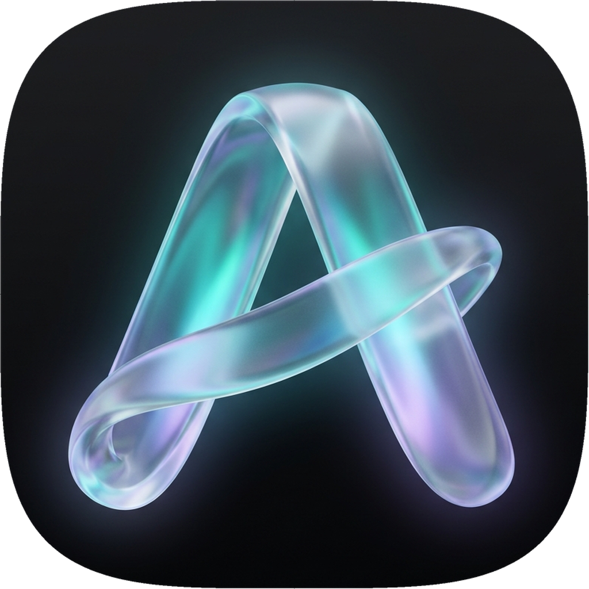
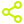

<div align="center">



# Aura

**Next-generation Android music client powered by YouTube Music, synchronized lyrics, universal scrobbling, and hardware-accelerated Liquid Glass.**

<p align="center">
  
  
  
  
</p>

</div>

---

<div align="center">
  
  
  
  <br/>
  <br/>
  
  
  
</div>

---

## Recent Updates & Enhancements

Aura includes core visual and architectural improvements over the original base:

* **Complete App Rebranding**: Renamed to **Aura** across all Gradle builds, manifest declarations, player notifications, and fourteen localized language packages.
* **Frosted Glass Icon**: Fresh adaptive icon suite spanning all density mipmaps (`mdpi` through `xxxhdpi`) featuring a centered translucent frosted aura ribbon glyph over an obsidian slate squircle.
* **Refined Backdrop Blur Pipeline**: Clean hardware-accelerated Liquid Glass rendering using RenderEffect shaders and Kyant Backdrop.

---

##  Key Features

| Icon | Feature | Highlight |
|:---:|:---|:---|
|  | **YouTube Music Client** | Stream tracks, albums, artists, and public playlists from YouTube Music with zero ads and background playback. |
|  | **Smart Playlist Generator** | Algorithmic taste mixes and mood radios generated from your listening history, seed artists, loved tracks, and top genres. |
|  | **Universal Last.fm Scrobbler** | Built-in media scrobbler tracking listening activity across YouTube Music, Spotify, Apple Music, and local players with zero battery drain. |
|  | **Real-Time Synced Lyrics** | Millisecond-accurate animated karaoke lyrics powered by LRCLIB with 8 customizable fluid physics motions. |
|  | **Offline Downloader** | One-tap downloads saved directly to local storage ( `Music/Aura` ), fully tagged with high-res cover art and synchronized `.lrc` lyrics. |
|  | **Discovery Feed & Genre DNA** | Personalized recommendation radar with deep genre breakdowns, weekly listening recaps, and instant "Start Mix" radios. |
|  | **Cross-Platform Playlist Import** | Instantly import public playlists from Spotify and Apple Music directly into your Aura library. |
|  | **Social Feed & Friends** | Follow friends' listening activity via Last.fm, browse their recent scrobbles, and explore their top tracks. |
|  | **Material 3 Expressive** | Dynamic wallpaper theming, custom HSL color palette engine, album art color extraction, fluid card animations, and tactile haptics. |

---

##  Tech Stack & Architecture

* **Language**: 100% Kotlin
* **UI Toolkit**: Jetpack Compose with Material 3 Expressive
* **Playback Engine**: AndroidX Media3 ExoPlayer with lockscreen controls and Android Auto integration
* **Local Storage**: Room Database with Jetpack DataStore preferences
* **Dependency Injection**: Dagger Hilt
* **Graphics Pipeline**: Kyant Backdrop with hardware RenderEffect shaders
* **Audio Pipeline**: AutoEQ headphone correction filters and USB DAC bit-perfect output handshake

---

##  Building from Source

Clone the repository and compile the release APK with Gradle:

```bash
git clone https://github.com/aniketdubey1204-code/aura.git
cd aura
./gradlew assembleRelease
```

Compiled APKs will be generated in `app/build/outputs/apk/release/`.

---

##  Disclaimer

Aura is an open-source educational and research project built to demonstrate Android media architecture with Jetpack Compose and AndroidX Media3. 

* Aura is an independent software project and has no affiliation with Google LLC, YouTube, YouTube Music, Spotify, Apple Inc., or Last.fm.
* Aura does not host, store, or distribute copyrighted media files. All streams and metadata are resolved through public endpoints. All trademarks belong to their respective owners.
