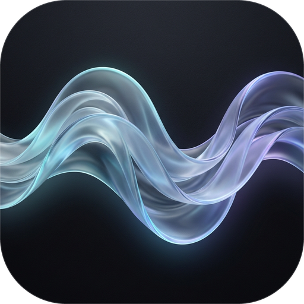
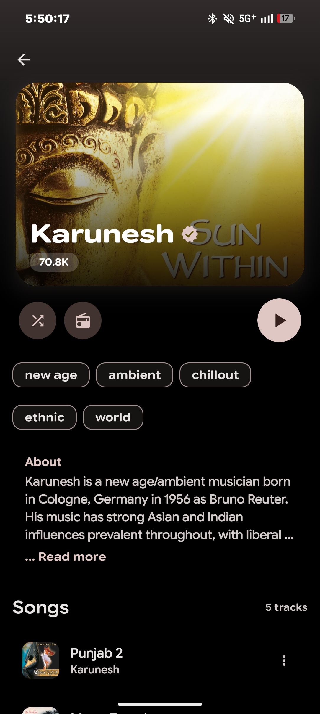
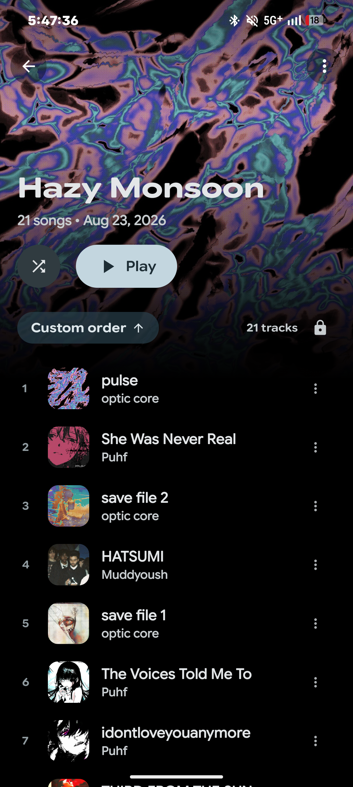
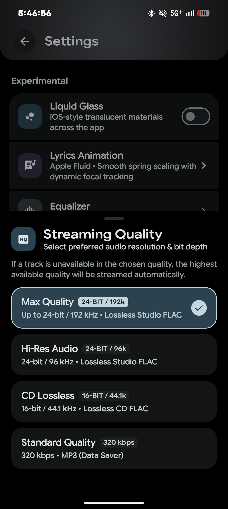
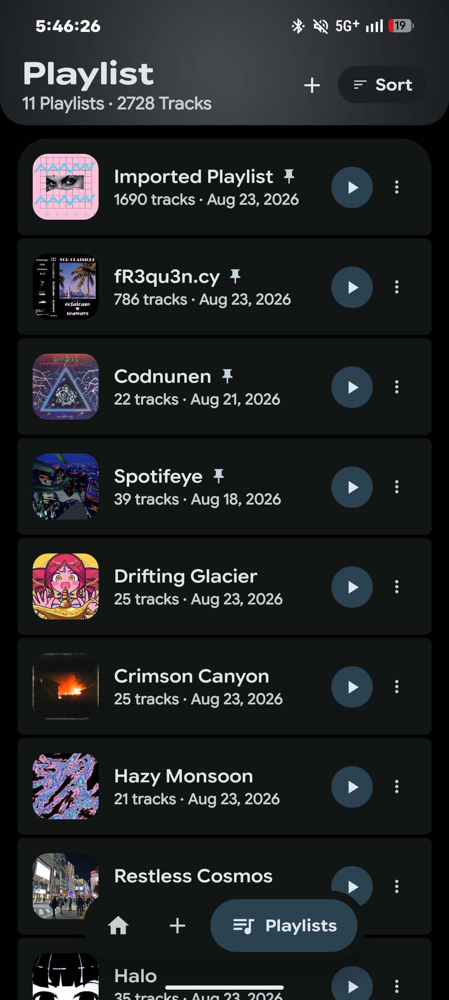
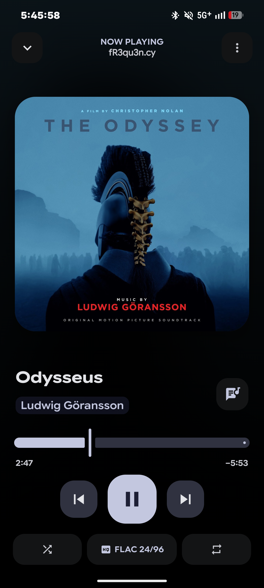
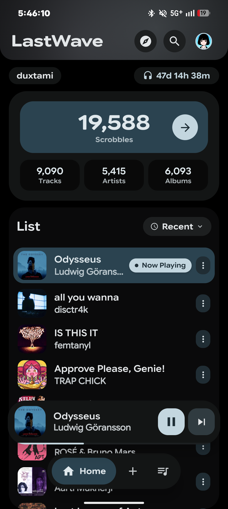

<div align="center">



# Wave

**Next-generation Android music client powered by YouTube Music, synchronized lyrics, universal scrobbling, and hardware-accelerated Liquid Glass.**

<p align="center">
  
  
  
  
</p>

</div>

---

<div align="center">
  
  
  
  <br/>
  <br/>
  
  
  
</div>

---

## Recent Updates & Enhancements

Wave includes core visual and architectural improvements over the original base:

* **Complete App Rebranding**: Renamed to **Wave** across all Gradle builds, manifest declarations, player notifications, and fourteen localized language packages.
* **Frosted Glass Icon**: Fresh adaptive icon suite spanning all density mipmaps (`mdpi` through `xxxhdpi`) featuring a centered translucent frosted wave glyph over an obsidian slate squircle.
* **Liquid Glass GPU Stabilization**: Fixed the backdrop frame-freeze bug on ARM Mali and MediaTek Dimensity chipsets (such as Realme, OnePlus, and Xiaomi). Unified the dual nested capture layers between the shell and media host into a single shared backdrop, and added an active compositor invalidation hook (`alpha = 0.999f`) to keep the glass moving smoothly during scrolls on every display.

---

## Core Features

* **YouTube Music Streaming**: Ad-free streaming powered by the YouTube Music catalog, complete with background playback and audio focus integration.
* **Synchronized Lyrics**: Millisecond-accurate animated karaoke lyrics powered by LRCLIB with fluid physics motions.
* **Universal Last.fm Scrobbler**: Built-in media scrobbler tracking your listening history across your preferred music players without battery drain.
* **Smart Playlist Generator**: Algorithmic mood mixes and taste radios built from your listening patterns, top artists, and favorite tracks.
* **Offline Music Storage**: One-tap downloads stored in `Music/Wave`, complete with embedded album artwork and `.lrc` lyric files.
* **Audiophile Output**: AutoEQ headphone correction filters, USB DAC bit-perfect output handshake, and 16 KB memory page compatibility for Android 15+.

---

## Tech Stack & Architecture

* **Language**: 100% Kotlin
* **UI Toolkit**: Jetpack Compose with Material 3 Expressive
* **Playback Engine**: AndroidX Media3 ExoPlayer with lockscreen controls and Android Auto integration
* **Local Storage**: Room Database with Jetpack DataStore preferences
* **Dependency Injection**: Dagger Hilt
* **Graphics Pipeline**: Kyant Backdrop with hardware RenderEffect shaders

---

## Building from Source

Clone the repository and compile the release APK with Gradle:

```bash
git clone https://github.com/aniketdubey1204-code/Wave.git
cd Wave
./gradlew assembleRelease
```

Compiled APKs will be generated in `app/build/outputs/apk/release/`.

---

## Disclaimer

Wave is an open-source educational and research project built to demonstrate Android media architecture with Jetpack Compose and AndroidX Media3. 

* Wave is an independent software project and has no affiliation with Google LLC, YouTube, YouTube Music, Spotify, Apple Inc., or Last.fm.
* Wave does not host, store, or distribute copyrighted media files. All streams and metadata are resolved through public endpoints. All trademarks belong to their respective owners.
